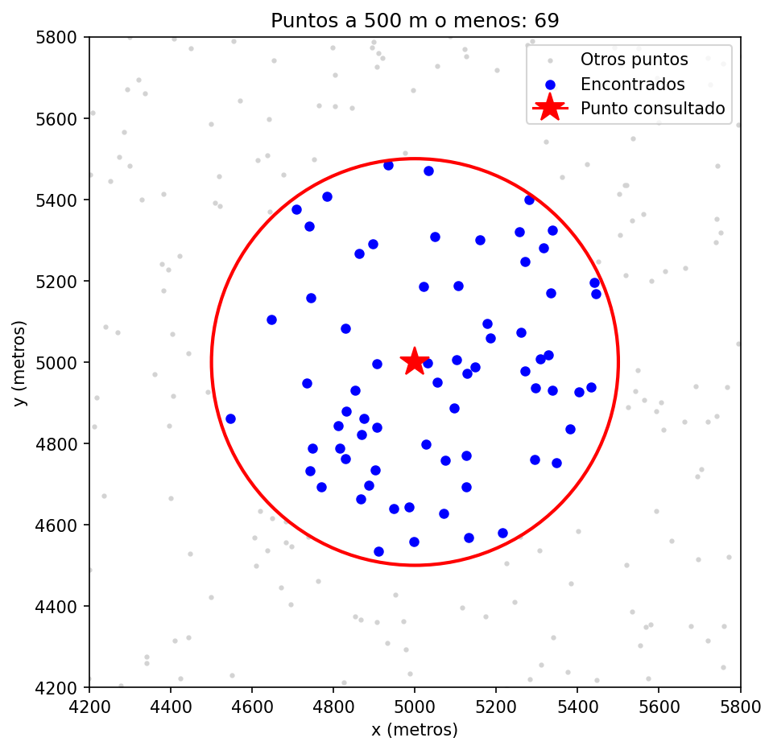
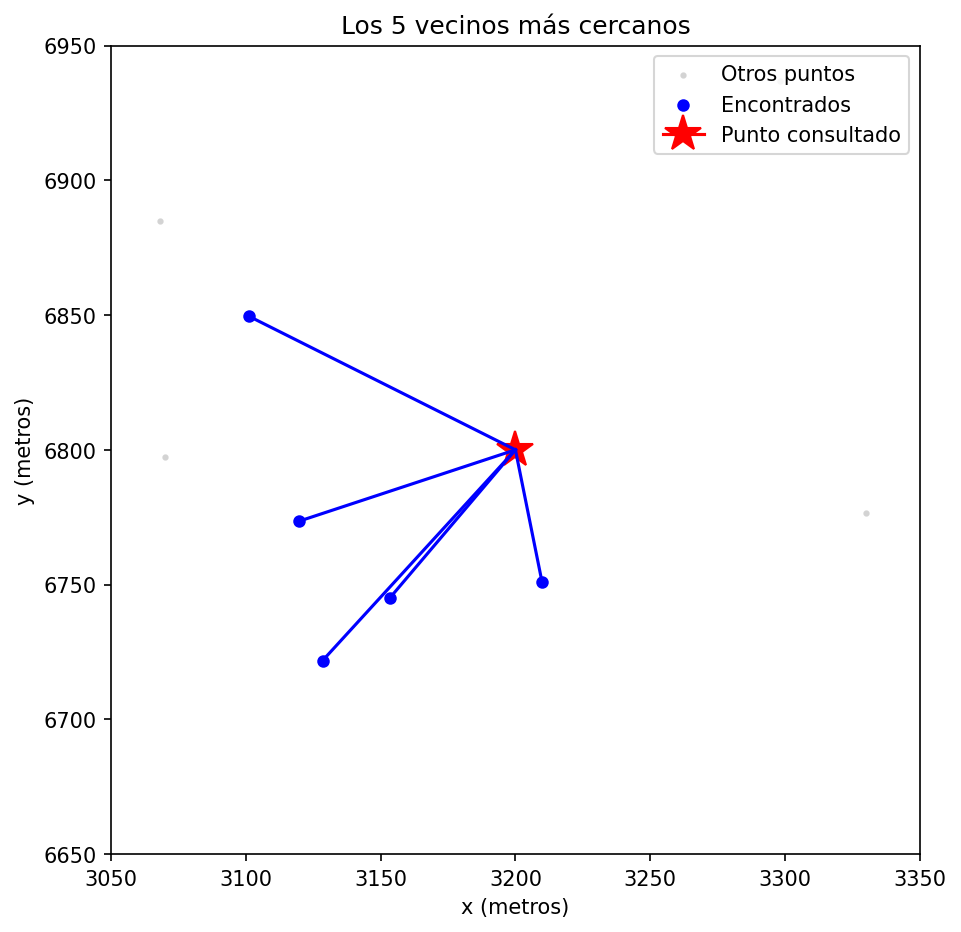
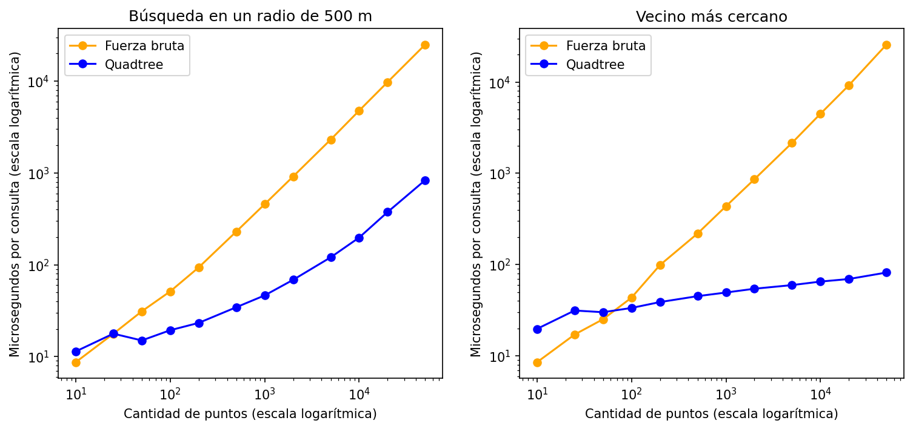

# Laboratorio 4: Quadtree para un sistema de entregas

Realizado por: Arelis Giraldo Mazo

## El problema

Un sistema de logística tiene **10.000 puntos de entrega** en una ciudad y debe responder rápido dos preguntas:

1. ¿Qué puntos de entrega están a **500 metros** o menos de un punto dado?
2. ¿Cuál es el punto de entrega **más cercano** a una ubicación dada?

Se implementó un **Quadtree desde cero** (sin scipy ni árboles ya hechos) y se comparó con la **fuerza bruta** (revisar todos los puntos de una lista).

## Cómo funciona el Quadtree

- El mapa se divide en **cajas** (rectángulos). Cada caja guarda máximo **4 puntos**.
- Cuando una caja se llena, se **parte en 4 cajas iguales** (suroeste, sureste, noroeste, noreste) y le reparte sus puntos a sus hijas.
- Donde hay más puntos, las cajas quedan más pequeñas.
- Al buscar, el árbol revisa primero si una caja **puede** tener puntos que sirvan, usando la distancia mínima del punto buscado a la caja. Si no puede, se salta toda la caja sin revisar sus puntos. A esto se le llama **poda**, y es lo que hace rápido al árbol.

## Datos y unidades

- Los 10.000 puntos se generan al azar con **semilla fija (42)**, así que siempre son los mismos (los datos son estáticos).
- Todo está en **metros**: la ciudad es un cuadrado de 10.000 m x 10.000 m (10 km de lado) y el radio de búsqueda es de 500 m.

## Decisiones de diseño

- **Capacidad 4** puntos por caja.
- **Profundidad máxima 20**: si se inserta el mismo punto muchas veces, el árbol no se divide para siempre.
- **Los puntos se guardan solo en las hojas** (las cajas que no tienen hijas).
- Un punto que cae justo en la línea entre dos cajas se guarda solo en la primera que lo acepta, así nunca queda duplicado.

## Archivos

| Archivo | Qué hace |
|---|---|
| `Quadtreetree.py` | Genera los puntos, la fuerza bruta y el Quadtree (clases `Caja` y `Nodo`) con la búsqueda por radio, los vecinos ordenados y el vecino más cercano. |
| `test.py` | Pruebas unitarias y gráficas de verificación visual. |
| `analisis.py` | Mide los tiempos del Quadtree y de la fuerza bruta con distintas cantidades de puntos. |
| `graficas/` | Imágenes generadas por `test.py` y `analisis.py`. |

## Pruebas (test.py)

Se hicieron 8 pruebas unitarias. La idea principal es que **el árbol debe dar exactamente lo mismo que la fuerza bruta**:

- La distancia y la caja calculan bien (dentro, fuera y distancia mínima).
- El árbol guarda exactamente los 10.000 puntos, sin perder ni duplicar ninguno.
- Un punto fuera del mapa es rechazado.
- 50 puntos repetidos no rompen el árbol.
- En **100 centros al azar**, la búsqueda por radio del árbol encuentra los mismos puntos que la fuerza bruta.
- En **100 ubicaciones al azar**, el vecino más cercano del árbol está a la misma distancia que el de la fuerza bruta.
- Los vecinos salen ordenados del más cercano al más lejano.

**Resultado: las 8 pruebas pasan.**

## Verificación visual

**Búsqueda por radio.** Los puntos azules son los que están a 500 m o menos del punto rojo. Todos quedan dentro del círculo y ningún punto gris está adentro.

**Vecinos más cercanos.** Los 5 puntos azules unidos con líneas son los 5 vecinos más cercanos al punto rojo. No hay ningún punto gris más cerca.

## Análisis comparativo (analisis.py)

Se midió el tiempo promedio de 300 búsquedas para cada cantidad de puntos (de 10 a 50.000), con los dos métodos y las mismas ubicaciones de búsqueda. Cada medición se repitió 5 veces y se tomó la más rápida, para reducir el ruido. Las mediciones se hicieron con el computador conectado, en modo de mejor rendimiento y sin otros programas abiertos.

Resultados (microsegundos por consulta; los números exactos cambian un poco según el computador):

| Puntos | Radio: fuerza bruta | Radio: Quadtree | Vecino: fuerza bruta | Vecino: Quadtree | Construir el árbol |
|---|---|---|---|---|---|
| 10 | 8,7 | 11,4 | 8,5 | 19,8 | 0,1 ms |
| 25 | 17,7 | 17,8 | 17,2 | 31,5 | 0,1 ms |
| 50 | 31,1 | 15,0 | 25,3 | 30,2 | 0,2 ms |
| 100 | 51,3 | 19,4 | 43,5 | 33,6 | 0,5 ms |
| 200 | 93,6 | 23,3 | 99,0 | 38,9 | 1,0 ms |
| 500 | 229,8 | 34,5 | 219,1 | 45,2 | 3,5 ms |
| 1.000 | 457,5 | 46,4 | 436,4 | 49,5 | 5,9 ms |
| 2.000 | 915,7 | 68,6 | 861,4 | 54,5 | 21,2 ms |
| 5.000 | 2.312,3 | 120,6 | 2.154,4 | 59,7 | 36,8 ms |
| 10.000 | 4.774,9 | 198,0 | 4.491,1 | 65,3 | 84,7 ms |
| 20.000 | 9.773,7 | 375,4 | 9.216,4 | 69,7 | 177,3 ms |
| 50.000 | 25.035,6 | 835,5 | 25.714,3 | 82,0 | 531,3 ms |

### ¿Para qué tamaño de datos el Quadtree empieza a ser más rápido?

- **Búsqueda por radio:** desde **50 puntos**. Con 25 puntos empatan (17,8 contra 17,7 microsegundos) y con 50 el árbol ya es el doble de rápido.
- **Vecino más cercano:** desde **100 puntos** (33,6 contra 43,5 microsegundos). Con 50 todavía gana la fuerza bruta.
- Con **10.000 puntos** (el tamaño del enunciado), el Quadtree fue unas **24 veces más rápido** en el radio y unas **69 veces más rápido** en el vecino más cercano.

### Discusión

- **Con pocos datos gana la fuerza bruta.** Cada paso del árbol cuesta más que revisar un punto de la lista: hay que llamar funciones, calcular la distancia a las cajas y bajar por los hijos. Con pocos puntos, recorrer una lista corta es más rápido que todo ese trabajo extra.
- **Con muchos datos gana el árbol.** La fuerza bruta crece en proporción a la cantidad de puntos: cada vez que los puntos se multiplican por 10, el tiempo también se multiplica por unas 10 (de 457 microsegundos con 1.000 puntos a 4.775 con 10.000). En la gráfica es una línea recta que sube. El árbol crece mucho más despacio, porque la poda le permite revisar solo las cajas cercanas.
- **El vecino más cercano casi no crece con el árbol:** pasa de 49,5 a 82 microsegundos mientras los puntos pasan de 1.000 a 50.000 (50 veces más puntos, menos del doble de tiempo). El récord baja rápido y se descartan casi todas las cajas.
- **La búsqueda por radio crece más que el vecino**, porque con más puntos hay más puntos dentro del círculo de 500 m, y todos se tienen que revisar y devolver. Aun así crece mucho más lento que la fuerza bruta.
- **El vecino tarda más en ganar que el radio** (100 puntos contra 50), probablemente porque el árbol hace más trabajo extra en esa búsqueda: además de calcular distancias a las cajas, ordena los hijos en cada nodo que visita.
- **Costo de construir el árbol:** construir el árbol de 10.000 puntos toma unos 85 ms. Ese tiempo se recupera después de unas 19 búsquedas por radio. Como los datos son estáticos, el árbol se construye una sola vez y se usa para muchas búsquedas, así que vale la pena.
- **Cuándo el árbol pierde ventaja:** si el radio es enorme (cubre casi toda la ciudad, no puede descartar cajas) o si todos los puntos están amontonados en un mismo lugar (el árbol se vuelve muy profundo).

## Código de honor

Yo, Arelis Giraldo, declaro que:

- Presento este trabajo para el Laboratorio 4 de Estructura de Datos.
- No copié soluciones completas de internet ni de compañeros.
- Usé inteligencia artificial (Claude, de Anthropic) como apoyo. La usé así:
  - Para que me explicara los conceptos (clases, recursión, árboles, Quadtree, poda y complejidad) y me guiara paso a paso.
  - Escribí una primera versión del Quadtree siguiendo las instrucciones y pistas paso a paso de la IA, que revisaba cada parte: generar los puntos, la distancia, la fuerza bruta, la clase Caja y la clase Nodo.
  - La IA escribió la búsqueda de los k vecinos más cercanos de esa primera versión y después reescribió todo en una forma más corta, que es la versión final de `Quadtreetree.py`. También escribió `test.py`, `analisis.py`, el código de las gráficas y me ayudo a redactar este README.
  - Corrí las pruebas y el análisis en mi computador. Los tiempos y las gráficas de este repositorio son los que obtuve yo.
- Estudié el código que entrego y me hago responsable de poder explicarlo.
