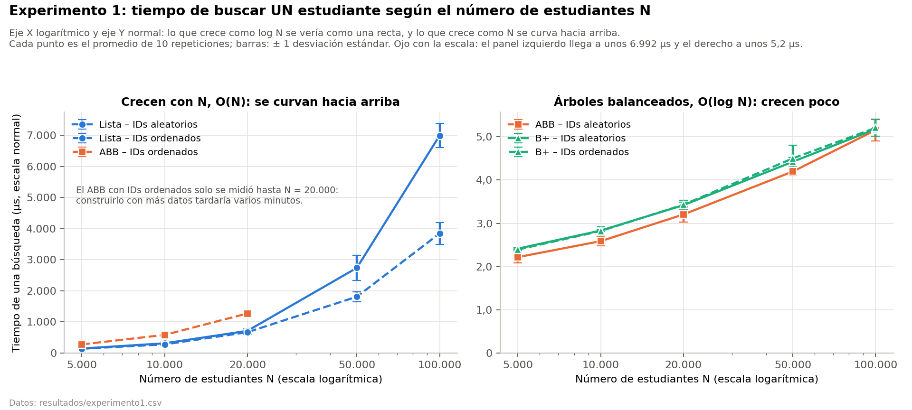
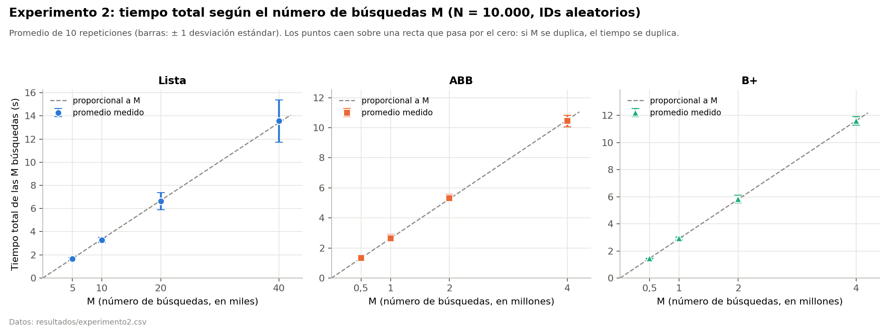
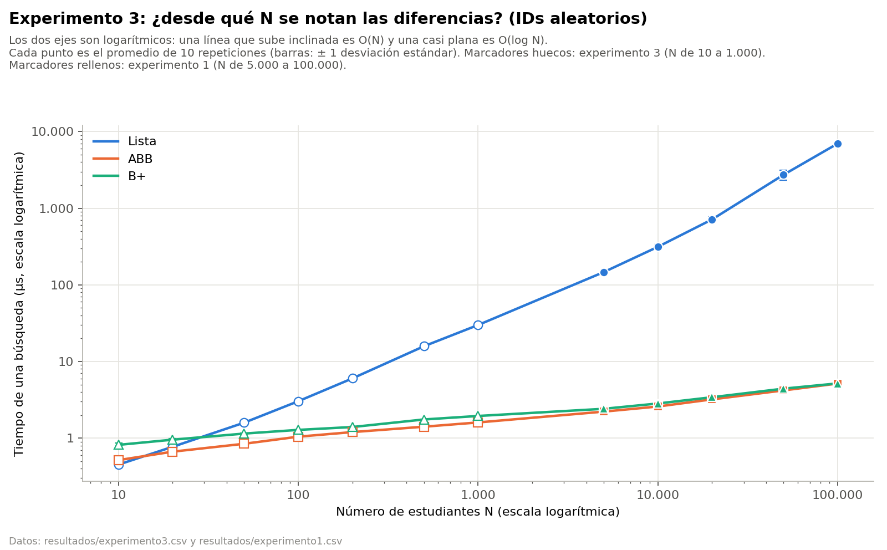

# Laboratorio 3: ¿cómo escala la búsqueda en una Lista, un ABB y un árbol B+?

**Autora:** Arelis Giraldo Mazo

**Curso:** Estructura de Datos · Universidad de Antioquia · Octubre de 2026

Estudio experimental del tiempo de búsqueda de tres estructuras de datos (lista enlazada, árbol binario de búsqueda y árbol B+) a medida que crece el número de estudiantes, con IDs insertados en orden aleatorio y en orden ascendente.

---

## 1. El problema

Una institución guarda estudiantes con **ID, nombre, edad y promedio**. El sistema debe **buscar** un estudiante por su ID, **insertar** estudiantes y **listarlos** en orden de ID. El ejercicio original resolvió esto con tres estructuras y midió 100 búsquedas con 10.000 estudiantes.

**Pregunta de este laboratorio:** ¿cómo cambia el tiempo de búsqueda cuando crece la cantidad de estudiantes (N), en cada estructura, y qué pasa cuando los IDs se insertan ya ordenados?

## 2. Las tres estructuras

| Estructura | Archivo | Cómo busca | Complejidad de la búsqueda |
|---|---|---|---|
| **Lista enlazada** | `lista_enlazada.py` | Recorre nodo por nodo desde el inicio hasta encontrar el ID | O(N) |
| **ABB** (árbol binario de búsqueda) | `arbol_abb.py` | En cada nodo va a la izquierda (menor) o a la derecha (mayor): descarta una parte del árbol en cada paso | O(log N) en promedio con IDs aleatorios; **O(N) si los IDs llegan ordenados** |
| **Árbol B+** (orden 4) | `arbol_bplus.py` | Baja por "claves guía" hasta una hoja; los datos están solo en las hojas, que están encadenadas. Cada nodo guarda máximo 3 claves y se divide al llegar a 4 | O(log N) siempre: al llenarse un nodo, se divide y el árbol crece parejo |

- **Insertar:** la lista inserta al inicio (O(1)); los árboles bajan hasta su lugar (O(log N) por inserción).
- **Listar en orden:** la lista recolecta todo y lo ordena; el ABB hace un recorrido inorden; el B+ recorre la fila de hojas.
- **Pruebas:** antes de medir, `pruebas.py` comprueba que las tres estructuras encuentren a todos los estudiantes, devuelvan `None` con un ID que no existe y listen en orden, con N de 1 a 5.000 e IDs aleatorios y ordenados.
- Las tres estructuras están escritas en Python, así que la comparación es justa (mismo lenguaje y mismo intérprete).

## 3. Diseño del experimento

| Experimento | Qué cambia | Para qué |
|---|---|---|
| **1 (principal)** | N de 5.000 a 100.000, con IDs aleatorios y ordenados | Ver cómo escala la búsqueda |
| **2** | M, el número de búsquedas (N fijo en 10.000) | Comprobar que dividir entre M es válido |
| **3** | N pequeños, de 10 a 1.000 (IDs aleatorios) | Ver desde qué N se notan las diferencias y si hay costos constantes |
| **Prueba de la caché** | Cómo quedan los IDs en la memoria (N = 100.000) | Explicar por qué la Lista con IDs aleatorios es más lenta |

### Experimento 1 (principal): variar N

| Parámetro | Valor | Justificación |
|---|---|---|
| Tamaños N | 5.000 · 10.000 · 20.000 · 50.000 · 100.000 | Valores sugeridos en clase. Cubren 20 veces de diferencia y caben en el tiempo disponible. Los N pequeños se estudian aparte, en el experimento 3 |
| Orden de los IDs | aleatorio (mezclados) y ordenado (1, 2, 3…) | El orden es lo que desbalancea al ABB |
| Búsquedas M | Según la tabla de abajo | Para que **cada medición dure más de 1 segundo** |
| Repeticiones | 10 por cada caso, con datos nuevos en cada una | Para sacar promedio y desviación estándar |
| ABB con IDs ordenados | Solo hasta N = 20.000 | Construirlo crece como N²: con 20.000 tarda ~23 s; con 100.000 serían ~10 minutos por repetición |

**Tabla de M (número de búsquedas por medición).** Se escogió **antes** de correr, con una prueba piloto:

| N | Lista y ABB ordenado | ABB aleatorio y B+ |
|---:|---:|---:|
| 5.000 | 10.000 | 1.000.000 |
| 10.000 | 5.000 | 1.000.000 |
| 20.000 | 2.500 | 1.000.000 |
| 50.000 | 1.000 | 1.000.000 |
| 100.000 | 500 | 1.000.000 |

Regla: en la Lista cada búsqueda cuesta proporcional a N, así que M × N = 50 millones (si N se multiplica por 10, M se divide entre 10). En los árboles cada búsqueda tarda casi lo mismo (2 a 6 µs), así que M es siempre 1.000.000. Así, cada medición duró entre 1,3 y 5,8 segundos.

### Experimento 2: variar M

N fijo en **10.000**, IDs aleatorios y 10 repeticiones. M se duplica en cada paso (×1, ×2, ×4, ×8): Lista **5.000 · 10.000 · 20.000 · 40.000**; ABB y B+ **500.000 · 1.000.000 · 2.000.000 · 4.000.000**.

**Para qué sirve:** si el tiempo total es proporcional a M, entonces dividir entre M para obtener "el tiempo de una búsqueda" es válido. Eso justifica comparar estructuras que hicieron distinta cantidad de búsquedas en los experimentos 1 y 3.

### Experimento 3: N pequeños

N = **10 · 20 · 50 · 100 · 200 · 500 · 1.000**, IDs aleatorios y 10 repeticiones. Responde dos preguntas que el experimento 1 no alcanza a ver, porque empieza en 5.000: desde qué N se notan las diferencias, y si hay costos constantes que hagan parecidas a estructuras de distinta complejidad.

Con N pequeño cada búsqueda tarda menos de 2 µs, así que hacen falta millones de búsquedas para pasar de 1 segundo:

| N | 10 | 20 | 50 | 100 | 200 | 500 | 1.000 |
|---|---:|---:|---:|---:|---:|---:|---:|
| M de la Lista | 5.000.000 | 3.000.000 | 1.500.000 | 1.000.000 | 500.000 | 200.000 | 100.000 |
| M del ABB y el B+ | 3.000.000 | 3.000.000 | 3.000.000 | 3.000.000 | 3.000.000 | 3.000.000 | 3.000.000 |

### Prueba aparte: la caché

`prueba_cache.py` mide el tiempo por nodo de la Lista con N = 100.000 en tres casos: IDs ordenados, IDs aleatorios, e IDs aleatorios en los que cada ID se crea de nuevo junto a su estudiante (así queda al lado en la memoria). Son 5 repeticiones de 1.000 búsquedas cada una. Sirve para comprobar la explicación de la sección 7.

### Cómo se mide cada prueba

1. **Datos.** Se crean N estudiantes con IDs del 1 al N. El nombre se escoge al azar de una lista de 6, la edad es un entero al azar entre 16 y 30 y el promedio un número al azar entre 0,0 y 5,0 (con un decimal). Si el orden es aleatorio, los IDs se mezclan con `random.shuffle`.
2. **Búsquedas.** Los IDs a buscar se sortean al azar entre 1 y N (todos existen), **antes** de prender el cronómetro, y **las tres estructuras buscan los mismos IDs**.
3. **Cronómetro 1:** insertar los N estudiantes (tiempo de construcción, dato informativo).
4. **Cronómetro 2:** hacer las M búsquedas (dato principal).
5. **Tiempo de una búsqueda** = cronómetro 2 ÷ M.

- **Reloj:** `time.perf_counter()`, el más preciso de Python.
- **Recolector de basura:** antes de cada cronómetro se limpia la memoria (`gc.collect()`) y se apaga el recolector de basura de Python (`gc.disable()`); al terminar se vuelve a prender. Es lo mismo que hace el módulo `timeit` de Python. Sin esto, sus pausas se sumaban al tiempo de construcción (durante las búsquedas no se activaba).
- **Disco:** cada medición se guarda en el CSV **después** de parar el cronómetro. Mientras se mide no se lee ni se escribe en el disco.
- **Semilla:** `random.seed(número de repetición)`, para que cualquiera pueda generar exactamente los mismos datos.

## 4. Entorno

| | |
|---|---|
| Equipo | Portátil Dell, AMD Ryzen 5 3450U (2,10 GHz, 4 núcleos / 8 hilos, 4 MB de caché L3), 8 GB de RAM (5,89 GB utilizables) |
| Sistema | Windows 11 (10.0.26200) |
| Software | Python 3.13.15 (CPython); matplotlib 3.10.9 para las gráficas |
| Condiciones | Cargador conectado, modo de energía "Máximo rendimiento", todos los demás programas cerrados, carpeta fuera de OneDrive; los experimentos se corrieron desde la terminal `cmd`, uno detrás de otro |
| Fecha | 6 de octubre de 2026. Los tres experimentos y la prueba de la caché se corrieron seguidos, en una sola sesión de unos 50 minutos |

## 5. Cómo repetir el experimento

```
pip install matplotlib
python pruebas.py          # Comprueba que las estructuras funcionan (segundos)
python experimento.py      # Experimento 1 (~20 min)    -> resultados/experimento1.csv
python experimento2.py     # Experimento 2 (~12 min)    -> resultados/experimento2.csv
python experimento3.py     # Experimento 3 (~12 min)    -> resultados/experimento3.csv
python prueba_cache.py     # Prueba de la caché (~2 min) -> resultados/prueba_cache.csv
python graficas.py         # Gráficas y tablas (segundos) -> graficas/*.png y resultados/tablas.md
```

- Antes de correr: conectar el cargador, poner "Máximo rendimiento", cerrar todos los programas y esperar un minuto. La guía paso a paso, con las condiciones del computador y un comando para correr todo seguido, está en [`COMO_CORRER.md`](COMO_CORRER.md).
- `graficas.py` no mide nada: solo lee los CSV. Las gráficas se pueden regenerar sin repetir los experimentos.
- Correr de nuevo un experimento **sobrescribe** su CSV.
- En un computador más rápido puede aparecer el aviso "¡Ojo! esta prueba duró menos de 1 segundo"; en ese caso hay que duplicar las M (ver `COMO_CORRER.md`).
- Nota: en este equipo, Windows bloqueó matplotlib 3.11.2 (Control inteligente de aplicaciones), así que se usó la versión 3.10.9 (`pip install "matplotlib<3.11"`).

## 6. Resultados

Todas las **625 mediciones** duraron más de 1 segundo: entre 1,3 y 5,8 s en el experimento 1, entre 1,2 y 17,5 s en el experimento 2, entre 1,3 y 6,0 s en el experimento 3 y entre 3,3 y 7,3 s en la prueba de la caché.

### Gráfica 1: tiempo de una búsqueda según N (experimento 1)



El eje X (N) está en escala logarítmica y el eje Y en escala normal. Con esta escala, lo que crece como N se **curva hacia arriba**, y lo que crece exactamente como log N se vería como una recta.
- **Izquierda:** la Lista y el ABB con IDs ordenados se curvan hacia arriba, porque son O(N).
- **Derecha:** el ABB con IDs aleatorios y el B+ crecen poco, porque son O(log N). Se curvan un poco hacia arriba por un efecto del hardware (la caché, sección 7).

Ojo con la escala: el panel izquierdo llega a unos 7.000 µs y el derecho a unos 5,2 µs.

### Gráfica 2: tiempo total según M (experimento 2)



En las tres estructuras los puntos caen sobre una recta que pasa por el cero: **si M se duplica, el tiempo se duplica** (×1,96 a ×2,04).

### Gráfica 3: desde N = 10 hasta N = 100.000 (experimentos 3 y 1)



Los dos ejes están en escala logarítmica. Los marcadores huecos son del experimento 3 (N de 10 a 1.000) y los rellenos del experimento 1 (N de 5.000 a 100.000), solo con IDs aleatorios. Con N = 10 la Lista empieza **por debajo** de los dos árboles; cruza al ABB antes de N = 20 y al B+ entre N = 20 y N = 50, y desde ahí se separa cada vez más.

### Tablas principales (promedio ± desviación estándar de 10 repeticiones)

**Experimento 1: tiempo de una búsqueda (µs), IDs aleatorios**

| N | Lista | ABB | B+ |
|---:|---:|---:|---:|
| 5.000 | 146,9 ± 1,8 | 2,22 ± 0,14 | 2,41 ± 0,02 |
| 10.000 | 313,8 ± 19,9 | 2,59 ± 0,11 | 2,83 ± 0,02 |
| 20.000 | 714,4 ± 63,5 | 3,20 ± 0,18 | 3,42 ± 0,06 |
| 50.000 | 2.737,8 ± 410,2 | 4,20 ± 0,09 | 4,42 ± 0,10 |
| 100.000 | 6.991,5 ± 394,4 | 5,16 ± 0,25 | 5,18 ± 0,02 |

**Experimento 1: tiempo de una búsqueda (µs), IDs ordenados**

| N | Lista | ABB | B+ |
|---:|---:|---:|---:|
| 5.000 | 138,9 ± 2,9 | 278,9 ± 2,6 | 2,39 ± 0,03 |
| 10.000 | 278,7 ± 22,1 | 584,7 ± 19,1 | 2,82 ± 0,09 |
| 20.000 | 670,9 ± 54,5 | 1.273,0 ± 42,5 | 3,43 ± 0,10 |
| 50.000 | 1.811,4 ± 159,1 | no se midió | 4,50 ± 0,30 |
| 100.000 | 3.844,4 ± 352,8 | no se midió | 5,21 ± 0,19 |

**Altura de los árboles (niveles)**

| N | log₂ N | ABB aleatorio | ABB ordenado | B+ aleatorio | B+ ordenado |
|---:|---:|---:|---:|---:|---:|
| 5.000 | 12,3 | 29,0 | 5.000 | 8,0 | 8 |
| 10.000 | 13,3 | 32,2 | 10.000 | 9,0 | 9 |
| 20.000 | 14,3 | 34,6 | 20.000 | 9,6 | 10 |
| 50.000 | 15,6 | 38,6 | — | 10,2 | 10 |
| 100.000 | 16,6 | 41,4 | — | 11,0 | 11 |

**Experimento 2 (N = 10.000)**

| Estructura | M | Tiempo total (s) | Tiempo de una búsqueda (µs) |
|---|---:|---:|---:|
| Lista | 5.000 → 40.000 | 1,66 → 3,28 → 6,64 → 13,55 | 332 · 328 · 332 · 339 |
| ABB | 0,5 → 4 millones | 1,32 → 2,65 → 5,32 → 10,44 | 2,64 · 2,65 · 2,66 · 2,61 |
| B+ | 0,5 → 4 millones | 1,44 → 2,92 → 5,83 → 11,59 | 2,89 · 2,92 · 2,91 · 2,90 |

**Experimento 3: tiempo de una búsqueda (µs), N pequeños, IDs aleatorios**

| N | Lista | ABB | B+ | La Lista tarda… |
|---:|---:|---:|---:|---|
| 10 | 0,45 | 0,52 | 0,82 | 0,9 veces el ABB y 0,6 veces el B+: **es la más rápida** |
| 20 | 0,77 | 0,67 | 0,95 | 1,2 veces el ABB y 0,8 veces el B+ |
| 50 | 1,59 | 0,84 | 1,15 | 1,9 y 1,4 veces más |
| 100 | 3,03 | 1,04 | 1,28 | 2,9 y 2,4 veces más |
| 200 | 6,02 | 1,20 | 1,40 | 5,0 y 4,3 veces más |
| 500 | 15,82 | 1,41 | 1,75 | 11,2 y 9,0 veces más |
| 1.000 | 29,94 | 1,60 | 1,95 | 18,7 y 15,4 veces más |

**Prueba de la caché (Lista, N = 100.000, 5 repeticiones)**

| Caso | Tiempo por nodo revisado |
|---|---:|
| IDs ordenados | 68,4 ± 2,7 ns |
| IDs aleatorios | 140,4 ± 3,9 ns |
| IDs aleatorios, cada ID creado junto a su estudiante | 73,4 ± 2,4 ns |

Las tablas completas, con las desviaciones del experimento 3, el tiempo de construcción y el M de cada caso, están en [`resultados/tablas.md`](resultados/tablas.md).

## 7. Análisis

**¿Los resultados se comportan como predice la teoría?** Sí. Cuando N se multiplica por 20 (de 5.000 a 100.000):

| | Lista aleatorio | Lista ordenado | ABB aleatorio | B+ aleatorio |
|---|---:|---:|---:|---:|
| El tiempo se multiplicó por | ×47,6 | ×27,7 | ×2,3 | ×2,2 |
| La teoría dice | ×20 (O(N)) | ×20 (O(N)) | ×1,35 (O(log N)) | ×1,35 (O(log N)) |

La Lista crece con N y los árboles casi no cambian. Con 100.000 estudiantes, los árboles son **unas 1.350 veces más rápidos** que la Lista. Los tiempos crecen algo más de lo que dice la teoría por un efecto del hardware, explicado más abajo.

**¿Cuándo deja el ABB de comportarse como O(log N)?** Cuando los IDs se insertan ordenados. Cada nuevo ID es mayor que todos los anteriores, así que siempre va a la derecha, y el árbol se vuelve una sola rama: **su altura es exactamente N**. La búsqueda pasa a ser O(N) (×4,6 cuando N se multiplica por 4) y queda **1,9 a 2,1 veces más lenta que la Lista**. Construirlo pasa a ser O(N²): 1,2 s → 4,9 s → 22,7 s (×18,9 cuando N se multiplica por 4; la teoría dice ×16).

**¿Qué relación hay entre la altura y el tiempo?** Buscar es bajar por el árbol, así que el tiempo sigue a la cantidad de nodos que se revisan:

| Caso (N de 5.000 a 100.000) | Nodos que revisa una búsqueda, en promedio | Tiempo de una búsqueda | Tiempo por nodo |
|---|---:|---:|---:|
| Lista, IDs aleatorios | 2.500 → 50.000 | 146,9 → 6.991,5 µs | 59 → 140 ns |
| Lista, IDs ordenados | 2.500 → 50.000 | 138,9 → 3.844,4 µs | 56 → 77 ns |
| ABB, IDs ordenados (hasta 20.000) | 2.500 → 10.000 | 278,9 → 1.273,0 µs | 112 → 127 ns |
| ABB, IDs aleatorios | ≈ 15 → ≈ 21 | 2,22 → 5,16 µs | ≈ 150 → 240 ns |
| B+ | 8 → 11 niveles | 2,41 → 5,18 µs | ≈ 300 → 470 ns por nivel |

- En la Lista y en el ABB ordenado, una búsqueda revisa en promedio la mitad de los nodos, (N + 1) / 2.
- En el ABB aleatorio, el promedio sale de la fórmula teórica para un ABB construido al azar (≈ 2·ln N − 1,8). Aunque su altura (el camino más largo) va de 29 a 41, una búsqueda típica baja de ~15 a ~21 niveles.
- El ABB ordenado revisa miles de nodos y tarda cientos de µs; el ABB aleatorio revisa unos 20 y tarda pocos µs. El B+ es el más bajo (de 8 a 11 niveles) y no cambia con el orden de los IDs.
- Lo que no sigue la teoría es el **costo de cada nodo**, que sube con N por la caché (ver abajo).

**¿Qué diferencias hay entre IDs aleatorios y ordenados?** Al ABB lo destruye el orden. Al B+ no le afecta: con 100.000 estudiantes tarda 5,18 µs con IDs aleatorios y 5,21 µs con ordenados. La Lista es O(N) en ambos casos, pero con N grande es más lenta con IDs aleatorios (1,8 veces con 100.000), por la caché.

**¿A partir de qué N se ven las diferencias?** El experimento 3 lo muestra:
- Con **N = 10**, la Lista es la **más rápida**: 0,45 µs, contra 0,52 µs del ABB y 0,82 µs del B+.
- Con **N = 20** queda entre los dos árboles.
- Desde **N = 50**, los dos árboles ya ganan: la Lista tarda 1,9 y 1,4 veces más.
- La ventaja de los árboles crece con N: 2,4 a 2,9 veces con 100, 15 a 19 veces con 1.000, ~60 veces con 5.000 y ~1.350 veces con 100.000.

Las diferencias se vuelven claras desde N ≈ 50–100 estudiantes.

**¿Hay costos constantes que hacen parecidos a algoritmos de distinta complejidad?** Sí:
- **La Lista (O(N)) le gana a los árboles (O(log N)) con N = 10.** Cada búsqueda tiene un costo fijo que no depende de N: llamar al método, preparar el recorrido y el propio ciclo de medición. Con 10 estudiantes la Lista revisa en promedio 5,5 nodos con un ciclo muy simple. El B+ baja solo 2 o 3 niveles, pero en cada uno recorre varias claves con un ciclo de Python y además llama a una función auxiliar (`_encontrar_hoja`); por eso su trabajo fijo pesa más.
- **El ABB y el B+ tardan lo mismo con 100.000 estudiantes (5,2 µs)**, aunque el B+ baja 11 niveles y el ABB revisa unos 21 nodos. Tienen la misma complejidad, pero cada nivel del B+ cuesta más.

**Efecto del hardware (caché).** La Lista con IDs aleatorios crece más rápido que N (×47,6 en vez de ×20) y, con N grande, es más lenta que con IDs ordenados, aunque revisa los mismos nodos. El costo por nodo sube de ~59 a ~140 ns. La causa es la memoria caché del procesador (4 MB):
- En Python, cada ID es un objeto guardado en la memoria.
- Los IDs se crean en orden (1, 2, 3…) y después se mezclan. Con IDs aleatorios, al recorrer la lista el procesador encuentra esos objetos en desorden y, como con N grande ya no caben en la caché, tiene que traerlos de la RAM, que es más lenta.
- **La prueba aparte lo confirma:** si cada ID se crea junto a su estudiante, la Lista con IDs aleatorios tarda casi lo mismo que con IDs ordenados (73 contra 68 ns por nodo), en vez de 140.

El mismo efecto explica por qué los árboles crecen ×2,2–2,3 y no ×1,35: los nodos que se revisan sí crecen como log N (×1,4), pero cada visita cuesta más cuando el árbol ya no cabe en la caché.

**¿Es válido dividir entre M?** Sí. En el experimento 2, cuando M se duplica el tiempo total se multiplica por 1,96 a 2,04, y el tiempo de una búsqueda casi no cambia (Lista 328–339 µs, ABB 2,61–2,66 µs, B+ 2,89–2,92 µs). Además es parecido al que dio el experimento 1 con N = 10.000 (Lista 314 µs, ABB 2,59 µs, B+ 2,83 µs).

## 8. Estadística y valores atípicos

- Se reporta el **promedio ± la desviación estándar** de 10 repeticiones.
- **La dispersión fue baja.** El coeficiente de variación (desviación ÷ promedio) quedó:
  - entre 0,5 % y 15 % en el experimento 1 (27 de los 28 casos por debajo del 10 %);
  - entre 1,3 % y 13,4 % en el experimento 2;
  - entre 1,1 % y 12,3 % en el experimento 3.
- **Valores atípicos:** solo 4 de las 610 mediciones de los tres experimentos se alejaron más de un 30 % de la mediana de su grupo:
  - la Lista con N = 50.000 e IDs aleatorios, en la repetición 7 (3.851 µs contra una mediana de 2.562 µs);
  - la Lista con M = 20.000 y M = 40.000, en la repetición 8 del experimento 2 (la misma repetición, probablemente una interrupción del sistema);
  - la Lista con N = 20, en la repetición 10 del experimento 3.
- **No se eliminó ningún dato**, porque los valores atípicos no cambian ninguna conclusión. Todos los datos crudos están en los CSV.

## 9. Limitaciones

- **Un solo computador y un solo lenguaje.** Los tiempos absolutos cambian de un equipo a otro, e incluso entre días en el mismo equipo (sección 10); lo que se compara son las tendencias.
- **Un portátil y no un equipo de escritorio o un servidor dedicado.** Un portátil puede bajar la velocidad por temperatura o por energía. Se controló con el cargador conectado, el modo "Máximo rendimiento", todo cerrado y 10 repeticiones.
- **El tiempo de construcción de la Lista dura milisegundos** (menos de 1 s), así que es solo un dato de referencia. Las construcciones confiables son las que duran segundos, como la del ABB ordenado.
- **El ABB ordenado solo se midió hasta N = 20.000**, por su costo O(N²) de construcción.
- **Solo se estudiaron búsquedas de IDs que existen, elegidos al azar.** No se estudiaron búsquedas fallidas, búsquedas por rango, ni eliminación. Listar en orden está implementado y comprobado con `pruebas.py`, pero no se le midió el tiempo.
- **El tiempo medido incluye el ciclo de medición** (el `for` que llama a `buscar`). Es un costo pequeño y fijo por búsqueda, igual para las tres estructuras; con N = 10 pesa más que con N grande.
- **El experimento 3 solo usa IDs aleatorios.**
- **El sistema operativo puede interrumpir.** Se controló con las condiciones de la sección 4 y con 10 repeticiones.

## 10. Prueba piloto y lecciones aprendidas

- Una **primera versión** del experimento sirvió como prueba piloto para escoger la tabla de M y el límite del ABB ordenado.
- En esa versión, la Lista con IDs aleatorios **no crecía con N**. Revisando, se encontró que los IDs a buscar quedaban correlacionados con el orden de inserción (se usaba la misma semilla para crear los datos y para sortear las búsquedas), así que se buscaban justo los últimos insertados. Se corrigió, y en esta versión los datos y las búsquedas salen de una misma secuencia aleatoria por repetición.
- **El entorno importa:** el mismo código, corrido con Zoom y navegadores abiertos, fue entre 3 y 5 veces más lento (Lista con N = 10.000: 2.172 µs contra ~380 µs). Por eso todas las mediciones finales se hicieron con el equipo controlado.
- **El recolector de basura:**
  - Una revisión del código encontró que el recolector de basura de Python se activaba mientras se construían las estructuras, aunque nunca durante las búsquedas. Eso metía saltos en el tiempo de construcción; por ejemplo, la Lista daba 0,032 s con 10.000 estudiantes y 0,011 s con 20.000.
  - Se corrigió apagándolo durante los cronómetros y se repitieron los tres experimentos. Ahora la construcción de la Lista crece parejo con N: 0,001 → 0,027 s.
- **Repetir el experimento confirma las tendencias:**
  - Hubo una corrida completa anterior del experimento 1 (5 de octubre, con la versión anterior del código). Comparada con ella, la corrida final fue entre un 8 % y un 31 % más rápida (16 % en promedio).
  - El crecimiento fue el mismo: la Lista con IDs aleatorios ×46 contra ×48, y el ABB ×2,1 contra ×2,3.
  - Los tiempos absolutos dependen del estado del equipo ese día; las tendencias y las conclusiones no.

## 11. Archivos del repositorio

```
├── README.md                 este documento
├── GUIA_SUSTENTACION.md      material de apoyo para la sustentación
├── COMO_CORRER.md            guía paso a paso para correr los experimentos
├── lista_enlazada.py         Lista enlazada
├── arbol_abb.py              Árbol binario de búsqueda
├── arbol_bplus.py            Árbol B+ (orden 4)
├── pruebas.py                Pruebas de las tres estructuras
├── experimento.py            Experimento 1 (variar N)
├── experimento2.py           Experimento 2 (variar M)
├── experimento3.py           Experimento 3 (N pequeños)
├── prueba_cache.py           Prueba aparte de la memoria caché
├── graficas.py               Gráficas y tablas a partir de los CSV
├── resultados/
│   ├── experimento1.csv      280 mediciones (10 repeticiones × 28 pruebas)
│   ├── experimento2.csv      120 mediciones (10 repeticiones × 12 pruebas)
│   ├── experimento3.csv      210 mediciones (10 repeticiones × 21 pruebas)
│   ├── prueba_cache.csv      15 mediciones (3 casos × 5 repeticiones)
│   └── tablas.md             tablas completas
└── graficas/
    ├── grafica1_busqueda_vs_N.png
    ├── grafica2_tiempo_vs_M.png
    └── grafica3_N_pequenos.png
```

## 12. Conclusiones

**Principales hallazgos:**

1. **La Lista es O(N) en la práctica.** Cuando N se multiplica por 20, su tiempo se multiplica por 27,7 (IDs ordenados) a 47,6 (IDs aleatorios). La teoría dice ×20; lo que sobra se explica por la caché.
2. **Con IDs aleatorios, el ABB y el B+ son O(log N).** Su tiempo solo se multiplica por 2,2–2,3, y con 100.000 estudiantes son unas 1.350 veces más rápidos que la Lista.
3. **Con IDs ordenados, el ABB se degenera.** Su altura es N, buscar es O(N) y tarda unas 2 veces más que la Lista, y construirlo es O(N²): 22,7 s con 20.000 estudiantes. El B+ no se afecta.
4. **Con pocos datos, la complejidad no decide.** Con 10 estudiantes la Lista es la más rápida, por los costos constantes. Los árboles ganan desde N ≈ 50 y la diferencia ya es enorme desde N ≈ 1.000.
5. **El costo de cada paso depende del hardware.** La cantidad de nodos revisados sigue la teoría, pero cada nodo cuesta más cuando los datos no caben en la caché. La prueba aparte lo confirma: 68 contra 140 ns por nodo.
6. **El método de medición es válido.** El tiempo total es proporcional a M, todas las mediciones duraron más de 1 segundo y la dispersión fue baja.

**Lo que estos datos no permiten concluir:**

- Cuánto tardaría en otro computador o en otro lenguaje: los tiempos absolutos cambian, incluso entre días.
- Qué pasa con más de 100.000 estudiantes, o con el ABB ordenado por encima de 20.000. Se espera lo mismo, pero no se midió.
- Nada sobre búsquedas fallidas, búsquedas por rango, eliminación o el tiempo de listar en orden.

## 13. Código de honor y uso de inteligencia artificial

- **Herramienta usada:** Claude (IA de Anthropic).
- **Para qué la usé:**
  - Discutir y decidir el diseño de los experimentos: valores de N, tablas de M, regla de 1 segundo y repeticiones.
  - Generar y corregir el código.
  - Agregar `altura()` y `listar_en_orden()` a los árboles.
  - Redactar este README y la guía de sustentación.
- **Lo que hice y verifiqué yo:**
  - Corrí todos los experimentos en mi computador. **Los datos son mediciones reales y no fueron modificados.**
  - Revisé que las gráficas y las tablas correspondan a los CSV.
  - Revisé que las conclusiones correspondan a los datos.
  - Entiendo el código, la metodología y los resultados.